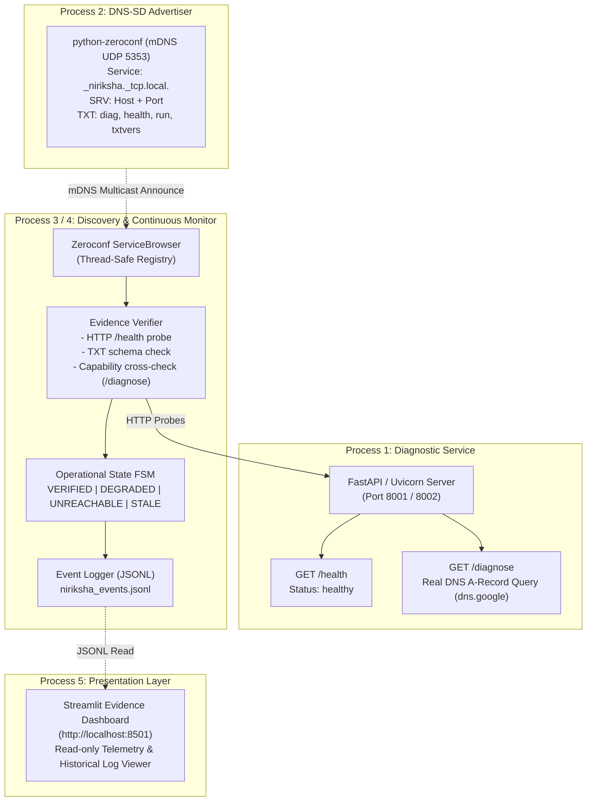
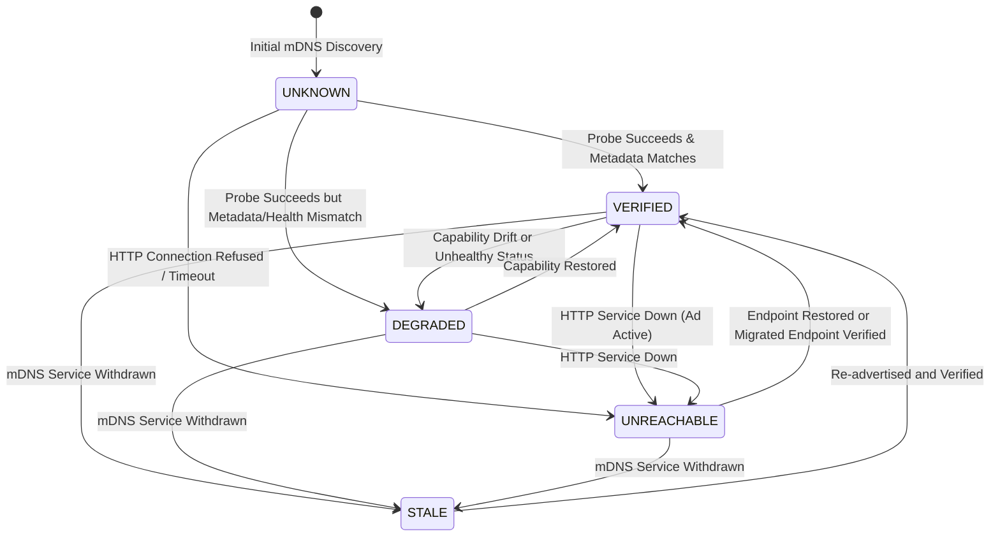

# NIRIKSHA — Discover. Examine. Verify.
### Evidence-Based Active Verification & Autonomous Migration for DNS-SD Diagnostic Services

**AIORI-3 Hackathon — Problem Statement PS-033**  
**Team:** DARSHAN 2.0  
**Team Code:** `A3-PS033-TC440`  
**Latest Automated Test Baseline:** `51 / 51 PASSED` (100% passing across unit, integration, migration, and dashboard test suites)  
**Latest Pushed Commit Baseline:** `87e2435`  

---

## Team Introduction Video & Submission References

**AIORI-3 Hackathon — Step 6 & Step 7**

* **Team Name:** DARSHAN 2.0
* **Team Code:** A3-PS033-TC440
* **Problem Statement:** PS-033 — DNS-Based Discovery of Diagnostic Services
* **Proposed Solution:** NIRIKSHA — “Discover. Examine. Verify.”

▶️ **YouTube Video:**  
**https://youtu.be/j814kD0HllM**

*This video presents the team's understanding of the problem statement, the proposed solution architecture, and the assigned roles of all team members as required for the AIORI-3 orientation.*

### Repository Documentation References
* **Technical Presentation Slides:** [NIRIKSHA_AIORI3_Presentation_A3-PS033-TC440.pdf](NIRIKSHA_AIORI3_Presentation_A3-PS033-TC440.pdf)
* **Team Video Submission File:** [TEAM_INTRODUCTION_VIDEO.md](TEAM_INTRODUCTION_VIDEO.md)
* **AIORI Hackathon Structure Reference:** [Proposed-structure-hackathon.pdf](Proposed-structure-hackathon.pdf)

---

## 1. Executive Summary & Problem Context (PS-033)

### The Problem: The DNS-SD "Advertisement vs. Reality" Gap
DNS-Based Service Discovery (DNS-SD, [RFC 6763](https://datatracker.ietf.org/doc/html/rfc6763)) and Multicast DNS (mDNS, [RFC 6762](https://datatracker.ietf.org/doc/html/rfc6762)) allow diagnostic and telemetry services on local networks to announce their existence dynamically using PTR, SRV, TXT, and A/AAAA records.

However, in real-world distributed environments:
1. **Advertisement $\neq$ Availability:** An mDNS responder may faithfully announce a service on UDP port 5353 even after the underlying HTTP daemon has crashed, hung, or been blocked by a firewall.
2. **Metadata $\neq$ Reality (Capability Drift):** TXT records claim capabilities (e.g., `diag=dns`, `health=/health`), but configuration changes or runtime regressions can cause the service to fail or respond with entirely different diagnostics.
3. **Ghost Endpoints & Stale Cache:** Network churn, improper shutdowns, or IP changes leave stale advertisements in consumer caches, leading client applications into silent request timeouts.
4. **Blind Endpoint Migration:** When a service migrates to a new port or host, consumers that do not actively cross-validate the new endpoint risk connecting to unverified or misconfigured replacement targets.

### The Solution: NIRIKSHA
**NIRIKSHA** (*Sanskrit for "Investigation / Deep Observation"*) bridges this gap with an active, evidence-driven verification pipeline. Rather than blindly trusting DNS-SD advertisements, NIRIKSHA treats DNS-SD records as **unverified claims**. It continuously reconciles advertised metadata against live HTTP diagnostic endpoints, classifies operational health through a strict four-state finite state machine (FSM), records high-precision monotonic telemetry into an append-only JSONL log, and tracks DNS-SD endpoint migrations with measured recovery times.

---

## 2. Core Capabilities & Key Contributions

* **Real mDNS/DNS-SD Discovery (Zero Hard-Coding):** Uses `python-zeroconf` to dynamically discover `_niriksha._tcp.local.` services from genuine network packets. Addresses, ports, and TXT key-value pairs are parsed at runtime without static network assumptions.
* **Deep Capability Cross-Validation:** Probes both `GET /health` (reachability and JSON health assertion) and `GET /diagnose` (actual runtime capability). Verifies that advertised TXT properties (e.g., `diag=dns`) strictly match observed diagnostic execution (`diagnostic: "dns_lookup"`).
* **Four-State Operational FSM:**
  * `VERIFIED`: Reachable, HTTP 200, healthy JSON payload, complete TXT keys, and confirmed matching diagnostic capability.
  * `DEGRADED`: Reachable, but returns non-healthy JSON, missing required TXT metadata, or demonstrates capability drift/mismatch.
  * `UNREACHABLE`: Advertisement exists on mDNS, but the HTTP endpoint fails to connect or times out.
  * `STALE`: The mDNS announcement has been actively withdrawn (`remove_service`); absence of advertisement confirmed.
* **Continuous Monitoring & JSONL Event Stream:** An independent monitoring loop watches the mDNS cache and periodically probes endpoints, emitting structured event records (`discovery`, `state_change`, `probe`, `endpoint_migration`) to `niriksha_events.jsonl`.
* **Autonomous DNS-SD Endpoint Migration (Phase 2B):** Monitors dynamic SRV record updates when a service migrates to a new port, automatically initiating deep verification on the replacement endpoint and recording measured recovery latencies.
* **High-Precision Monotonic Telemetry:** Distinguishes between **[Measured]** discrete durations (using `time.monotonic()`) and **[Estimated]** intervals that span asynchronous polling gaps.
* **Read-Only Telemetry Dashboard (Phase 3A):** A modern Streamlit interface visualizing live or historical verification data, service inventories, latency timeseries, migration sequence flows, and filterable event logs.

---

## 3. System Architecture & Workflows

NIRIKSHA operates as four decoupled processes communicating over network protocols and an append-only event stream:



### Operational State Transition Lifecycle



---

## 4. Implemented Technology Stack

The NIRIKSHA codebase relies exclusively on standard, lightweight, cross-platform Python libraries:

| Component | Technology | Version | Purpose |
|:---|:---|:---|:---|
| **Diagnostic HTTP Service** | FastAPI + Uvicorn | `0.115.12` / `0.34.3` | Asynchronous REST service serving `/health` and live `/diagnose` |
| **DNS-SD / mDNS Engine** | python-zeroconf | `0.143.0` | Real RFC 6762 / RFC 6763 mDNS publishing and browsing |
| **Active Verifier Client** | HTTPX | `0.28.1` | Asynchronous/synchronous HTTP client with precise timeout controls |
| **Live Diagnostics Engine**| dnspython | `2.7.0` | Live recursive DNS resolver querying public nameservers (`dns.google.`) |
| **Evidence Dashboard** | Streamlit | `1.42.2` | Data-driven operational dashboard and historical telemetry visualizer |
| **Automated Test Suite** | pytest | `8.3.5` | Unit, integration, FSM, and end-to-end regression testing |
| **Scripting & Automation** | Windows PowerShell | 5.1+ / 7+ | Execution scripts with parameter passing and process orchestration |

---

## 5. Repository Directory Structure

```text
D:\aiori\A3-PS033-TC440
├── niriksha_events.jsonl              # Real append-only event log generated by monitor
├── pyproject.toml                     # Pytest configuration and pythonpath mappings
├── requirements.txt                   # Pinned production and test dependencies
├── README.md                          # Comprehensive project documentation
├── TEAM_INTRODUCTION_VIDEO.md         # Team orientation video reference
├── NIRIKSHA_AIORI3_Presentation_*.pdf # Official hackathon presentation deck
├── Proposed-structure-hackathon.pdf   # Hackathon structure guidelines
│
├── scripts/                           # Validated Windows PowerShell operational scripts
│   ├── run_service.ps1                # Launch FastAPI diagnostic HTTP service (-Port)
│   ├── run_advertiser.ps1             # Launch DNS-SD advertiser (-Port, fault flags)
│   ├── run_discovery.ps1              # Run one-shot mDNS discovery + verifier
│   ├── run_monitor.ps1                # Run continuous monitor + event logger
│   ├── run_dashboard.ps1              # Launch Streamlit evidence dashboard (-Port)
│   └── run_migration_demo.ps1         # Automated end-to-end migration demonstration
│
├── src/niriksha/                      # Main Python package
│   ├── __init__.py                    # Package exports and version
│   ├── models.py                      # Data models: ServiceState, ServiceRecord, VerificationResult
│   ├── service.py                     # FastAPI HTTP diagnostic service (/health, /diagnose)
│   ├── advertiser.py                  # Zeroconf DNS-SD publisher with fault/migration injection
│   ├── verifier.py                    # Deep capability cross-verifier and probe engine
│   ├── discovery.py                   # One-shot mDNS discovery client and verifier
│   ├── monitor.py                     # Continuous polling monitor, FSM, and JSONL logger
│   ├── monitor_runner.py              # CLI entry point for continuous monitor
│   ├── dashboard_data.py              # Decoupled data parsing, analytics, and freshness engine
│   └── dashboard.py                   # Streamlit multi-tab evidence dashboard UI
│
└── tests/                             # Comprehensive automated test suite (51 tests)
    ├── __init__.py
    ├── test_verifier.py               # Unit tests for verifier, TXT validation, and FSM timing
    ├── test_e2e.py                    # Integration tests against live uvicorn servers
    ├── test_migration.py              # FSM and live E2E DNS-SD endpoint migration tests
    └── test_dashboard.py              # Dashboard analytics, log parsing, and freshness tests
```

---

## 6. Installation & Environment Setup

### Prerequisites
* **Operating System:** Windows 10 / 11 / Server (or Linux/macOS with equivalent shell)
* **Python:** Python 3.10 to 3.13 (Python 3.13.5 verified)
* **Shell:** Windows PowerShell (`powershell.exe`)

### Setup Instructions

1. **Clone or Open Repository:**
   ```powershell
   cd D:\aiori\A3-PS033-TC440
   ```

2. **Create and Activate Virtual Environment:**
   ```powershell
   python -m venv .venv
   .\.venv\Scripts\Activate.ps1
   ```

3. **Install Pinned Dependencies:**
   ```powershell
   pip install --upgrade pip
   pip install -r requirements.txt
   ```

4. **Verify Windows Firewall Configuration (mDNS Multicast):**
   mDNS uses UDP port 5353. If running across separate network hosts or if blocked by Windows Defender Firewall, allow inbound UDP 5353:
   ```powershell
   netsh advfirewall firewall add rule name="mDNS-UDP-In" protocol=UDP dir=in localport=5353 action=allow
   ```
   *(For single-machine localhost testing, packets loop back automatically without modifying firewall rules).*

---

## 7. Step-by-Step Execution Guide

NIRIKSHA provides dedicated PowerShell wrappers in the `scripts/` directory for clean, modular execution.

### Step 1: Start the Diagnostic HTTP Service (Process 1)
Starts the FastAPI service listening for diagnostic HTTP requests.
```powershell
powershell -ExecutionPolicy Bypass -File scripts\run_service.ps1 -Port 8001
```
*Direct Python alternative:*
```powershell
.\.venv\Scripts\uvicorn.exe niriksha.service:app --host 0.0.0.0 --port 8001 --log-level info
```
*Verification URLs:*
* Health: `http://localhost:8001/health`
* Live DNS Diagnostic: `http://localhost:8001/diagnose`

---

### Step 2: Start the DNS-SD Advertiser (Process 2)
Registers the service via mDNS under the service type `_niriksha._tcp.local.`, announcing port 8001, local IP address, and TXT capability records (`diag=dns`, `health=/health`, `run=/diagnose`, `txtvers=1`).
```powershell
powershell -ExecutionPolicy Bypass -File scripts\run_advertiser.ps1 -Port 8001
```
*Direct Python alternative:*
```powershell
$env:PYTHONPATH = "src"
python -m niriksha.advertiser --port 8001
```

---

### Step 3: Run the One-Shot Discovery Client (Process 3)
Listens for mDNS advertisements, resolves the SRV/A/TXT records, and immediately performs an active HTTP verification probe against `/health`.
```powershell
powershell -ExecutionPolicy Bypass -File scripts\run_discovery.ps1
```
*Direct Python alternative:*
```powershell
$env:PYTHONPATH = "src"
python -m niriksha.discovery --timeout 30
```
*Expected Console Output:*
```text
[DISCOVERY] [FOUND] Service added via mDNS:
  Instance : niriksha-diagnostic._niriksha._tcp.local.
  Port     : 8001
  Addresses: ['192.168.1.X']
  TXT      : {'diag': 'dns', 'txtvers': '1', 'health': '/health', 'run': '/diagnose'}
[VERIFIER] Sending HTTP GET to http://192.168.1.X:8001/health
[VERIFIER] HTTP Status       : 200
[VERIFIER] Response Time     : 4.12 ms
[VERIFIER] Reachable         : True
[VERIFIER] Verdict           : [PASS] Operationally Verified
```

---

### Step 4: Run the Continuous Monitor (Process 4)
Runs continuously in the background, listening for mDNS advertisements, executing deep capability verifications every 10 seconds (or immediately on endpoint change), tracking state transitions, and writing structured JSONL telemetry to `niriksha_events.jsonl`.
```powershell
powershell -ExecutionPolicy Bypass -File scripts\run_monitor.ps1
```
*Direct Python alternative with custom parameters:*
```powershell
$env:PYTHONPATH = "src"
python -m niriksha.monitor_runner --interval 10 --timeout 8 --log niriksha_events.jsonl --discovery-wait 15
```

---

### Step 5: Launch the Streamlit Evidence Dashboard (Process 5)
Launches the interactive telemetry dashboard connected to `niriksha_events.jsonl`.
```powershell
powershell -ExecutionPolicy Bypass -File scripts\run_dashboard.ps1 -Port 8501
```
*Direct Python alternative:*
```powershell
$env:PYTHONPATH = "src"
python -m streamlit run src\niriksha\dashboard.py --server.port 8501 --server.address localhost --server.headless true
```
*Dashboard URL:* **`http://localhost:8501`**

---

## 8. Reproducing Controlled Fault Scenarios

NIRIKSHA includes built-in fault-injection flags in `advertiser.py` to prove that its active verifier detects discrepancies that passive DNS-SD discovery ignores.

### Fault Scenario A: Service Unreachable (HTTP Daemon Crash)
* **Hypothesis:** When an advertised HTTP service stops, mDNS advertisement may persist. Passive discovery fails to notice, but NIRIKSHA detects the outage.
* **Reproduction:**
  1. Start advertiser on port 8001 (`scripts\run_advertiser.ps1 -Port 8001`).
  2. Do not start the service (or kill an active service on port 8001).
  3. Run monitor (`scripts\run_monitor.ps1`).
* **Observed Verdict:** Monitor attempts HTTP probe, encounters `ConnectError` or `TimeoutException`, and transitions service state to **`UNREACHABLE`** with reason `"HTTP probe failed: ConnectError"`.

---

### Fault Scenario B: Port Misconfiguration / Ghost Port
* **Hypothesis:** An advertiser advertises port `9999` in the SRV record while the real daemon listens on port `8001`.
* **Reproduction:**
  1. Start service on port 8001:
     ```powershell
     powershell -File scripts\run_service.ps1 -Port 8001
     ```
  2. Start advertiser injecting wrong port 9999:
     ```powershell
     powershell -File scripts\run_advertiser.ps1 -Port 8001 -InjectPort 9999
     ```
  3. Observe monitor:
* **Observed Verdict:** Service record resolves to port 9999. Probe fails to connect. Classified as **`UNREACHABLE`** despite active mDNS advertisement.

---

### Fault Scenario C: Capability Drift (TXT Metadata Mismatch)
* **Hypothesis:** An advertiser advertises `diag=http` in its TXT record, but the service only implements DNS diagnostics (`diagnostic: "dns_lookup"`).
* **Reproduction:**
  1. Start real service on port 8001:
     ```powershell
     powershell -File scripts\run_service.ps1 -Port 8001
     ```
  2. Start advertiser injecting wrong TXT capability `http`:
     ```powershell
     powershell -File scripts\run_advertiser.ps1 -Port 8001 -InjectDiag http
     ```
  3. Observe monitor:
* **Observed Verdict:** Health check on `/health` passes HTTP 200, but capability cross-check on `/diagnose` detects:  
  `"Capability mismatch: TXT advertises diag='http' but /diagnose reports diagnostic='dns_lookup'"`.  
  State transitions to **`DEGRADED`**.

---

### Automated DNS-SD Endpoint Migration Demonstration (Phase 2B)
To witness end-to-end autonomous failover and migration recovery in a single command, execute the automated migration script:

```powershell
powershell -ExecutionPolicy Bypass -File scripts\run_migration_demo.ps1
```

**Automated Script Execution Flow:**
1. Spawns Service A on port `8001`.
2. Spawns Service B on port `8002` (standby replacement target).
3. Spawns DNS-SD Advertiser on port `8001`, scheduled to update SRV to port `8002` in 15 seconds.
4. Spawns Continuous Monitor (`--interval 4`).
5. At $T=8\text{s}$, abruptly terminates Service A to simulate an endpoint outage (`UNREACHABLE`).
6. At $T=15\text{s}$, the advertiser issues an in-place mDNS SRV update to port `8002`.
7. The monitor intercepts the mDNS update, triggers immediate deep verification against port `8002`, confirms health and capabilities, and recovers state to **`VERIFIED`**.
8. Automatically terminates child processes and prints the logged recovery events.

---

## 9. Streamlit Evidence Dashboard (Phase 3A)

The Streamlit dashboard runs locally at **`http://localhost:8501`** and operates strictly in **read-only mode**, visualizing structured events emitted to `niriksha_events.jsonl`.

### Key Dashboard Sections

#### 1. Header & Telemetry Freshness Status
* Displays the log file connection status and file size.
* **Freshness Indicator:** Calculates the exact elapsed time between current system time and the most recent logged event timestamp.
  * **🟢 Active:** Recent events within 120 seconds.
  * **⚠️ Historical Telemetry Notice:** If no event has occurred in $>120$ seconds, an alert explicitly notifies the user that the displayed statuses represent **last observed historical verdicts** and do not guarantee live process availability.

#### 2. Top KPI Metric Strip
* Total Discovered Services (historical unique count).
* Last VERIFIED Services.
* Last DEGRADED Services (capability mismatch count).
* Last UNREACHABLE Services.
* STALE Services (confirmed mDNS-withdrawn).
* Recorded Endpoint Migrations & Total Probe Count.

#### 3. Tab 1: Discovered Services & Last Observed Verdict
* Per-instance breakdown showing instance name, current operational state badge, last observed verdict string, active endpoint (`host:port (IP)`), advertised TXT capability, and probe latency.
* **Diagnostic Inspector:** Expandable panel displaying raw advertised TXT properties, full HTTP probe measurements, and a 3-way validation checklist (TXT fields present, `/health` JSON valid, capability matches TXT).

#### 4. Tab 2: DNS-SD Endpoint Migration & Autonomous Recovery
* Visual step sequence flow showing endpoint progression:
  $$\text{Port 8001 (VERIFIED)} \longrightarrow \text{Port 8001 (UNREACHABLE)} \longrightarrow \text{Port 8002 (REDISCOVERED)} \longrightarrow \text{Port 8002 (VERIFIED)}$$
* Four dedicated metric cards:
  * **Rediscovery Latency [Measured]:** Monotonic duration from fault detection to mDNS announcement of new endpoint.
  * **Recovery Latency [Measured]:** Monotonic duration from fault detection to successful verification of replacement endpoint.
  * **Est. Total Recovery Latency [Estimated]:** Monotonic time from last known good verification to replacement verification.
  * **Est. Rediscovery Latency [Estimated]:** Monotonic interval from last known good verification to rediscovery.

#### 5. Tab 3: Performance & Latency Telemetry
* Monotonic latency telemetry cards: Health Latency (Latest & Average), Verification Latency (Latest & Average), and Estimated Failure Detection Latency.
* **Interactive Line Chart:** Visualizes real-time and historical latency trends over time for both `/health` probes and full `/diagnose` capability verifications.

#### 6. Tab 4: Filterable Event Timeline
* Chronological event log supporting multi-criteria filtering:
  * Filter by Event Type (`state_change`, `endpoint_migration`, `probe`, `discovery`).
  * Filter by Operational State (`VERIFIED`, `DEGRADED`, `UNREACHABLE`, `STALE`).
  * Full-text search over instance names, ports, and reason strings.
* Interactive Data Table with reverse-chronological ordering and raw JSON inspection panel.

---

## 10. Timing Methodology: Measured vs. Estimated Distinctions

To maintain absolute scientific and engineering integrity, NIRIKSHA formally distinguishes between **strictly measured durations** and **statistically estimated intervals**:

| Metric | Type | Method of Calculation | Why the Distinction Matters |
|:---|:---|:---|:---|
| `health_latency_ms` | **Measured** | `time.perf_counter()` wrapping `client.get(/health)` | Direct measurement of HTTP network round-trip time. |
| `verification_latency_ms`| **Measured** | `time.monotonic()` wrapping start of `/health` to completion of `/diagnose` | Complete duration of one end-to-end active verification cycle. |
| `rediscovery_latency_ms` | **Measured** | `time.monotonic()` from recorded fault detection to mDNS update reception | Measures the exact observer-side reaction time once failure is confirmed. |
| `recovery_latency_ms` | **Measured** | `time.monotonic()` from recorded fault detection to replacement verified | Measures true time-to-recovery under active observation. |
| `estimated_detection_latency_ms` | **Estimated** | `started_at_mono - last_verified_mono` | Faults happen asynchronously between polling cycles. True instant of failure is unknown; interval includes poll gap. |
| `estimated_total_recovery_latency_ms` | **Estimated** | `finished_at_mono - last_verified_mono` | Total recovery duration bounded by the last confirmed healthy observation. |

---

## 11. Automated Test Suite & Baseline

NIRIKSHA includes an extensive automated test suite covering unit logic, integration with live servers, state machine transitions, endpoint migration lifecycles, and dashboard analytics.

### Running Pytest
Execute from the project root:
```powershell
.\.venv\Scripts\pytest -v --tb=short
```

### Verified Test Breakdown (51 / 51 Passing)

| Test Module | Tests | Scope & Assertions Tested |
|:---|:---:|:---|
| `tests/test_verifier.py` | **25** | Unit tests for `ServiceState` enum, required TXT keys, JSON parsing, capability cross-checking, HTTP timeout handling, FSM transitions, and monotonic clock accuracy. |
| `tests/test_e2e.py` | **7** | Live integration tests spawning real FastAPI/Uvicorn processes: normal verification (`VERIFIED`), stopped service (`UNREACHABLE`), wrong advertised port (`UNREACHABLE`), and capability mismatch (`DEGRADED`). |
| `tests/test_migration.py` | **6** | FSM migration event parsing, lifecycle transitions (`UNREACHABLE -> VERIFIED`), degraded capability on migrated targets, and full live server migration and recovery. |
| `tests/test_dashboard.py` | **13** | JSONL parsing, service state derivation, summary KPI computation, performance metric aggregations, migration extraction, search/filter logic, log freshness calculation, and backwards-compatibility with real logs. |
| **Total** | **51** | **All 51 tests passing consistently.** |

---

## 12. Technical Limitations & Scope Boundaries

In accordance with hackathon guidelines, NIRIKSHA states its technical boundaries transparently:

1. **Multicast Scope (Layer 2 Boundary):** Standard mDNS ([RFC 6762](https://datatracker.ietf.org/doc/html/rfc6762)) operates via link-local multicast on UDP 5353 (`224.0.0.251`). Multicast packets do not cross IP subnets or enterprise routers without an mDNS gateway/reflector.
2. **Local Windows Demonstration:** Tested and verified on Windows 10/11 environments using Python 3.13 and IPv4 endpoints. Dual-stack IPv6 transport is not implemented in the current prototype.
3. **Out-of-Scope Features (Not Implemented):**
   * Wide-Area Unicast DNS-SD across public authoritative DNS zones ([RFC 6763 §11](https://datatracker.ietf.org/doc/html/rfc6763#section-11)).
   * Service Registration Protocol (SRP) or Thread/6LoWPAN mesh discovery.
   * Cryptographic authentication (DNSSEC for mDNS / TLS mutual authentication); endpoints currently communicate over cleartext HTTP.
   * Containerized cluster orchestration (Kubernetes/Docker Compose) — modular standalone processes with PowerShell scripts are utilized to ensure simple, inspectable, and reproducible judging.

---

## 13. Official AIORI Submission Metadata

* **Hackathon:** All India Open Research Initiative (AIORI-3)
* **Problem Statement:** PS-033 — DNS-Based Discovery of Diagnostic Services
* **Team Name:** DARSHAN 2.0
* **Team Code:** `A3-PS033-TC440`
* **Project Name:** NIRIKSHA — “Discover. Examine. Verify.”
* **Official Team Orientation Video:** [https://youtu.be/j814kD0HllM](https://youtu.be/j814kD0HllM)
* **Code Repository:** `https://github.com/aiori-hackathon/A3-PS033-TC440.git`
* **Baseline Commit:** `87e2435`


